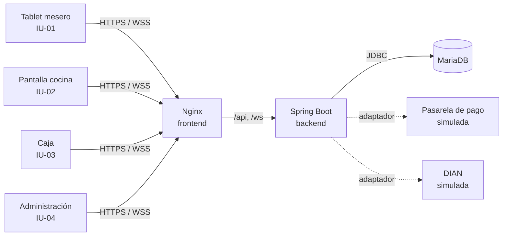

# Comanda

Sistema web de gestión operativa para restaurantes pequeños y medianos: toma de pedidos por mesa desde tablet, comandas en tiempo real a cocina, control de inventario por receta, cobro con factura electrónica y cierre de caja. Proyecto de Ingeniería de Software II — Universidad del Quindío.

> Los requisitos se levantaron con el **Restaurante El Buen Sabor** como cliente de referencia. El nombre del restaurante es configurable (`RESTAURANTE_NOMBRE`), así que el mismo sistema sirve para cualquier establecimiento.

## Alcance de esta versión (v0.3)

| Caso de uso | Estado | Funcionalidades |
|---|---|---|
| **CU-01 Gestionar Pedido** | ✅ Completo | F-01 a F-13 (incluye F-08 cola de comandas con ACK y reenvío) |
| **CU-02 Cobro y Cierre de Caja** | ✅ Completo (pasarela y DIAN simuladas) | F-14 a F-20 |
| CU-04 Gestionar Inventario | 🟡 Parcial | F-21 consulta de stock, alertas de mínimo y entradas de mercancía |
| CU-03, CU-05, CU-06 | ⏳ Próximas versiones | Gestión de menú, reservas y reportes por período |

Documentación del proyecto en [`docs/`](docs/): documento de arquitectura (C4 + C4+1), plan de requisitos v3, diagramas fuente (PlantUML) e importación para Jira.

## Las 6 funcionalidades para la demostración

| # | Funcionalidad | Dónde se ve | Requisitos |
|---|---|---|---|
| 1 | **Mesas y menú en tiempo real** con disponibilidad calculada por receta | Tablet del mesero | F-01, F-02 |
| 2 | **Registrar pedido** con validación concurrente de stock y descuento de inventario | Tablet del mesero | F-03, F-04, F-05, F-06 |
| 3 | **Comanda en cocina en tiempo real** con cola persistente, ACK y reenvío si se cae la conexión | Pantalla de cocina + tablet | F-07, F-08, F-09 |
| 4 | **Preparación y aviso al mesero** (máquina de estados, notificación y recordatorio a los 5 min) | Cocina → tablet | F-10, F-11, F-12 |
| 5 | **Cobro con factura electrónica**: efectivo con cambio, tarjeta por pasarela, pago dividido, CUFE validado por la DIAN y liberación de la mesa | Módulo de caja | F-14 a F-19 |
| 6 | **Conciliación y cierre de caja** con reporte diario a la DIAN y bloqueo de la jornada | Panel de administración | F-20 (+ F-21 inventario) |

## Stack

| Capa | Tecnología |
|---|---|
| Base de datos | MariaDB 11.4 · migraciones con Flyway |
| Backend | Spring Boot 3.4 (Java 21) · JPA · Spring Security (JWT) · WebSocket/STOMP autenticado |
| Frontend | Angular 19 (componentes standalone, signals) · `@stomp/stompjs` |
| Contenedores | Docker Compose · Nginx sirve el frontend y hace de proxy a la API |
| Calidad | JUnit 5 + Mockito + AssertJ · JaCoCo · GitHub Actions (CI) · prueba de humo de extremo a extremo |



## Puesta en marcha local

### Requisitos

- [Docker Desktop](https://www.docker.com/products/docker-desktop/) (o Docker Engine + Compose v2)
- Git

No hace falta instalar Java, Node ni MariaDB: todo se compila y ejecuta dentro de los contenedores.

### Pasos

```bash
git clone https://github.com/SSeanjjo/gestion-restaurantes.git
cd gestion-restaurantes
cp .env.example .env        # en Windows (PowerShell): copy .env.example .env
docker compose up --build
```

La primera vez tarda unos minutos (descarga imágenes y dependencias). Cuando termine:

| Qué | Dirección |
|---|---|
| Aplicación | http://localhost:8081 |
| Documentación de la API (Swagger) | http://localhost:8081/swagger-ui.html |
| API directa | http://localhost:8080/api |
| MariaDB (cliente externo) | `localhost:3307` · usuario/clave del `.env` |

Al arrancar, Flyway crea las tablas y carga los datos iniciales automáticamente.

### Usuarios de prueba

| Usuario | Contraseña | Rol | Pantalla |
|---|---|---|---|
| `mesero1` | `mesero123` | Mesero | Tablet del mesero (IU-01) |
| `mesero2` | `mesero123` | Mesero | Tablet del mesero (IU-01) |
| `cocina` | `cocina123` | Cocinero | Pantalla de cocina (IU-02) |
| `caja` | `caja123` | Cajero | Módulo de caja (IU-03) |
| `admin` | `admin123` | Administrador | Panel de administración (IU-04) y caja |

### Guion de demostración

Abra cuatro ventanas (use ventanas de incógnito o perfiles distintos): `mesero1`, `cocina`, `caja` y `admin`.

1. **Mesero:** toque una mesa verde, agregue platos y confirme. La mesa pasa a rojo y la comanda aparece en cocina al instante.
2. **Stock:** la semilla deja **Chicharrón** con 150 g, suficiente para una sola bandeja paisa. Si pide dos, el sistema rechaza el pedido indicando el plato afectado sin perder los demás. **Mojarra frita** aparece *Sin stock* y **Cazuela de mariscos** no aparece porque está suspendida.
3. **Cocina:** pulse *Iniciar preparación*, marque los platos y luego *Marcar como listo*.
4. **Mesero:** aparece la notificación verde de plato listo. Pulse *Marcar servido* y luego *Solicitar cuenta*.
5. **Caja:** la mesa aparece como *Cuenta solicitada*. Elija *Efectivo*, *Tarjeta* o *Dividido* y pulse *Registrar pago y generar factura*. Con una tarjeta terminada en **0000** la pasarela simula un rechazo. Al cobrar, la factura queda validada (CUFE) y la mesa vuelve a verde en la tablet.
6. **Administrador:** el resumen muestra las ventas del día. En *Cierre de caja* verifique la conciliación (opcionalmente con el efectivo contado) y cierre: se genera el comprobante del reporte a la DIAN y ya no se aceptan pedidos ni cobros ese día.

**Probar F-08 (pérdida de conexión):** cierre la pestaña de cocina y confirme un pedido: la tablet muestra *Cocina sin conexión · 1 comanda en cola*. Al volver a abrir cocina, la comanda aparece y el aviso desaparece. Si es la **tablet** la que pierde la red (modo avión), el pedido queda guardado en el dispositivo y se envía solo al recuperar la conexión, sin duplicarse.

Para abrir la tablet desde un dispositivo real en la misma red Wi-Fi, use `http://<IP-de-su-PC>:8081`.

### Prueba automática de extremo a extremo

Con el sistema recién levantado (`docker compose down -v && docker compose up -d --build`):

```bash
./scripts/prueba-humo.sh      # requiere curl y jq
```

Recorre por la API las funcionalidades 1 a 6, incluidos los cursos alternos (stock insuficiente, salto de estado, tarjeta rechazada, reintento idempotente, permisos por rol y caja cerrada). La misma prueba corre en GitHub Actions en cada *push*.

### Comandos útiles

```bash
docker compose up -d --build     # arrancar en segundo plano
docker compose logs -f backend   # ver los logs del backend
docker compose down              # detener
docker compose down -v           # detener y BORRAR la base de datos (vuelve a los datos iniciales)
```

> Después del cierre de caja el sistema no acepta pedidos ni cobros hasta el día siguiente (modo M-02). Para seguir probando el mismo día use `docker compose down -v`.

## Arquitectura en una página

Monolito modular en capas (Controlador → Servicio → Repositorio) con eventos de dominio. Detalle completo, diagramas C4 (contexto, contenedores, componentes, código) y diagramas de secuencia C4+1 en [`docs/arquitectura`](docs/arquitectura/).

| Patrón | Dónde | Para qué |
|---|---|---|
| **Facade** | `PedidoService`, `CajaService` | Una operación del sistema por método (contratos 1, 2 y 3) |
| **Strategy** | `ReglaDisponibilidad`, `ProcesadorPago` (`PagoEfectivo`, `PagoTarjeta`) | Algoritmos intercambiables sin `switch` (abierto/cerrado) |
| **Adapter** (puertos y adaptadores) | `PasarelaPago`, `ServicioFacturacionElectronica` → `*Simulada` | Aislar al dominio de los sistemas externos IS-01 e IS-02 |
| **Observer** | `Eventos` + `PublicadorTiempoReal`, `ColaComandas`, `PresenciaCocina` | Difundir cambios por WebSocket sin acoplar los módulos |
| **State** (máquina de estados declarativa) | `EstadoPedido` | RD-03: sin saltos ni retrocesos |
| **Builder** | `Factura.builder()` | Construir la factura solo si está completa |
| **Transactional Outbox** | `EntregaComanda` | F-08: ninguna comanda se pierde |
| **Chain of Responsibility** | `AutenticacionStompInterceptor` | Autenticar y autorizar cada trama STOMP |
| **Repository** | `*Repository` (Spring Data) | Acceso a datos |

## Catálogo de recetas e inventario

| Archivo | Contenido |
|---|---|
| `backend/src/main/resources/db/migration/V1__esquema.sql` | Tablas del CU-01 |
| `backend/src/main/resources/db/migration/V2__datos_iniciales.sql` | Mesas, usuarios, ingredientes, platos y **recetas** |
| `backend/src/main/resources/db/migration/V3__f08_cola_comandas_y_cu02_caja.sql` | Cola de comandas, factura, pago y cierre de caja |
| `backend/src/main/resources/db/migration/R__stock_inventario.sql` | **Semilla de stock** (editable) |

Cada receta indica cuánto de cada ingrediente consume **una unidad** del plato:

- **Menú (F-02):** un plato está disponible si hay stock para preparar al menos una unidad.
- **Al confirmar (F-05):** se suma el consumo de todo el pedido y se compara con el stock, con los ingredientes bloqueados (`SELECT … FOR UPDATE`) para que dos tablets no gasten el mismo stock a la vez.
- **Descuento (F-06):** en la misma transacción que registra el pedido. Cada movimiento queda en `movimiento_inventario`.

Para cargar stock con el sistema en marcha, use el panel de administración (*Inventario → Sumar*) o `POST /api/inventario/entradas`. Para fijar valores de desarrollo, edite `R__stock_inventario.sql` y reinicie el backend.

## Desarrollo sin reconstruir contenedores

```bash
docker compose up -d db

# Backend (en otra terminal)
cd backend
DB_PORT=3307 DB_PASSWORD=comanda_dev mvn spring-boot:run

# Frontend (en otra terminal) → http://localhost:4200
cd frontend
npm install
npm start
```

### Pruebas y cobertura

```bash
cd backend && mvn verify       # pruebas + reporte en target/site/jacoco/index.html
```

| Suite | Qué verifica |
|---|---|
| `EstadoPedidoTest` | Máquina de estados RD-03 (sin saltos ni retrocesos) |
| `CalculadoraRecetaTest` | Disponibilidad y consumo por receta (F-02, F-06) |
| `PoliticaSuscripcionTest` | Permisos por rol en los tópicos WebSocket (RNF-04) |
| `ColaComandasTest` | Cola de comandas, ACK idempotente y reenvío (F-08) |
| `DesgloseTest` | Total con impuesto al consumo incluido (RF-06) |
| `CalculadoraCufeTest` | CUFE SHA-384 determinista (RF-07) |
| `ProcesadoresPagoTest` | Efectivo con cambio, tarjeta aprobada y rechazada (RF-08, 5a) |
| `CajaServiceTest` | Contrato 3: factura, liberación de mesa y reverso de tarjeta si la DIAN rechaza |
| `ResumenJornadaTest` | Conciliación del cierre de caja (RF-10, RF-11) |
| `scripts/prueba-humo.sh` | Recorrido completo por la API con base de datos real |

## API y tiempo real

| Método | Ruta | Rol | Funcionalidad |
|---|---|---|---|
| POST | `/api/auth/login` | — | Iniciar sesión (devuelve JWT) |
| GET | `/api/mesas` | Mesero, Cajero, Admin | F-01 Estado de mesas |
| GET | `/api/mesas/{numero}/pedido-activo` | Mesero, Cajero, Admin | F-01 Pedido activo de la mesa |
| GET | `/api/menu` | Mesero, Admin | F-02 Menú con disponibilidad |
| POST | `/api/pedidos` | Mesero | F-03, F-05, F-06, F-07 Registrar pedido (acepta `claveIdempotencia`) |
| GET | `/api/pedidos/cocina` | Cocinero, Admin | F-09 Comandas activas |
| POST | `/api/pedidos/cocina/ack` | Cocinero | F-08 Confirmar recepción de comandas |
| GET | `/api/pedidos/cocina/estado` | Mesero, Cocinero, Admin | F-08 Cocina conectada y comandas en cola |
| PATCH | `/api/pedidos/{id}/estado` | Cocinero | F-10 Iniciar preparación / marcar listo |
| PATCH | `/api/pedidos/{id}/detalles/{detalleId}` | Cocinero | F-10 Marcar plato preparado |
| GET | `/api/pedidos/notificaciones` | Mesero | F-11 Notificaciones pendientes |
| POST | `/api/pedidos/{id}/servido` | Mesero | F-12 Marcar servido |
| POST | `/api/pedidos/{id}/solicitar-cuenta` | Mesero | F-14 Solicitar cuenta |
| POST | `/api/pedidos/{id}/anular` | Mesero, Admin | F-13 Anular pedido |
| GET | `/api/caja/cuentas` | Cajero, Admin | F-15 Mesas con cuenta |
| GET | `/api/caja/cuentas/{pedidoId}` | Cajero, Admin | F-15 Desglose con impuesto |
| POST | `/api/caja/cuentas/{pedidoId}/cobro` | Cajero, Admin | F-16 a F-19 Pago y factura electrónica |
| GET | `/api/caja/facturas` | Cajero, Admin | RF-09 Registro de caja del día |
| GET | `/api/caja/resumen-dia` | Admin | F-20 Conciliación y métricas del día |
| POST | `/api/caja/cierre` | Admin | F-20 Cierre de caja y reporte DIAN |
| GET | `/api/caja/cierres` | Admin | Historial de cierres |
| GET | `/api/recetas` | Admin | Catálogo de recetas |
| GET / POST | `/api/inventario`, `/api/inventario/entradas` | Admin | F-21 Stock y entradas |

Eventos STOMP (endpoint `/ws`, la trama `CONNECT` exige `Authorization: Bearer <jwt>`):
`/topic/mesas`, `/topic/menu`, `/topic/cocina`, `/topic/estado-cocina`, `/topic/meseros/{usuarioId}`, `/topic/inventario/alertas`, `/topic/caja`. Cada rol solo puede suscribirse a sus tópicos (`PoliticaSuscripcion`). Los eventos se publican después del *commit*.

## Trazabilidad con el plan de requisitos

| ID | Funcionalidad | Jira | Implementación |
|---|---|---|---|
| F-01 | Seleccionar mesa y consultar su pedido activo | EBS-1 | ✅ `MesaService` · cuadrícula 4 columnas actualizada por WebSocket |
| F-02 | Consultar menú disponible por categoría | EBS-2 | ✅ `MenuService` + `ReglaDisponibilidad` |
| F-03 | Registrar pedido asociado a una mesa | EBS-3 | ✅ `PedidoService.crearPedido` transaccional |
| F-04 | Modificar pedido antes de confirmarlo | EBS-4 | ✅ Controles +/−/eliminar de 44 px |
| F-05 | Validar disponibilidad al confirmar | EBS-5 | ✅ `ConsumoIngredientesPedido.reservar` con bloqueo de filas |
| F-06 | Descontar ingredientes al confirmar | EBS-6 | ✅ Misma transacción; alerta al llegar al mínimo |
| F-07 | Enviar comanda a cocina en tiempo real | EBS-7 | ✅ Evento WebSocket tras el commit |
| F-08 | Almacenar y reenviar comandas sin conexión | EBS-8 | ✅ `ColaComandas` (outbox + ACK + reenvío ordenado) y cola local en la tablet con idempotencia |
| F-09 | Visualizar comandas y tiempo en cola | EBS-9 | ✅ Temporizador verde/ámbar/rojo |
| F-10 | Marcar plato / pedido como listo | EBS-10 | ✅ Máquina de estados; bloqueo de doble pulsación |
| F-11 | Notificar al mesero que el plato está listo | EBS-11 | ✅ Solo al mesero asignado; reenvío cada 5 min |
| F-12 | Marcar pedido como servido | EBS-12 | ✅ Pasa a *Entregado* y queda disponible en caja |
| F-13 | Anular pedido | EBS-13 | ✅ Solo en *Registrado*; reintegra inventario y audita |
| F-14 | Solicitar la cuenta | EBS-14 | ✅ Estado E-07 visible en caja |
| F-15 | Consultar cuenta con total calculado | EBS-15 | ✅ `Desglose` (INC 8 % incluido en precios) |
| F-16 | Registrar pago en efectivo con cambio | EBS-16 | ✅ `PagoEfectivo` |
| F-17 | Pago con tarjeta por pasarela bancaria | EBS-17 | ✅ `PagoTarjeta` + `PasarelaPago` (simulada) |
| F-18 | Dividir el pago entre efectivo y tarjeta | EBS-18 | ✅ Varias partes por factura; reverso si falla |
| F-19 | Generar factura electrónica DIAN | EBS-19 | ✅ `Factura.builder()`, CUFE SHA-384, `DianSimulada`; libera la mesa |
| F-20 | Conciliar y ejecutar el cierre de caja | EBS-20 | ✅ `ResumenJornada`, `CierreCajaService`; reporte DIAN y modo M-02 |
| F-21 | Consultar inventario, alertas y entradas | EBS-21 | ✅ Panel IU-04 |

## Decisiones tomadas y temas por validar con el cliente

- **F-08 (conflicto RF-02 vs. M-03):** se resolvió a favor de M-03: el servidor guarda una fila por comanda (`entrega_comanda`) en la misma transacción del pedido; la cocina la confirma (ACK) y las no confirmadas se reenvían en orden y sin duplicados. Si la que pierde la red es la tablet, el pedido se guarda en el dispositivo y se reintenta con una clave de idempotencia.
- **Impuesto:** los restaurantes liquidan **impuesto nacional al consumo (8 %)**, no IVA; se asumió que los precios del menú ya lo incluyen (el cliente paga la suma de los platos). La tarifa es configurable (`FACTURA_TARIFA_IMPUESTO`).
- **Pasarela y DIAN** se integran mediante adaptadores simulados. Pasar a producción es escribir los adaptadores reales (REST del banco y SOAP de la DIAN) sin cambiar la lógica de cobro.
- **Cierre de caja:** con inconsistencias el administrador debe revisarlas y autorizarlas explícitamente (curso alterno 9a). Tras el cierre no se aceptan pedidos ni cobros ese día.
- **F-10:** *En preparación* lo marca el cocinero con *Iniciar preparación*.
- **F-13:** solo se anula un pedido *Registrado*, por el mesero que lo tomó o un administrador.
- **Mesas reservadas:** se permite abrir pedido en una mesa *Reservada* (RD-01 solo lo prohíbe si está *Ocupada*).

## Pendientes técnicos conocidos

- Faltan pruebas de integración con base de datos real en Java (p. ej. Testcontainers) para la concurrencia de F-05; hoy la cubre la prueba de humo de extremo a extremo.
- HTTPS (RNF-01) se configurará al desplegar fuera del entorno local (Nginx con certificado).
- Gestión de menú (CU-03), reservas (CU-05) y reportes por período (CU-06).

## Estructura del repositorio

```
gestion-restaurantes/
├── docker-compose.yml
├── .env.example
├── .github/workflows/ci.yml      Integración continua (pruebas, build y prueba de humo)
├── scripts/prueba-humo.sh        Prueba de extremo a extremo por la API
├── docs/                         Arquitectura (C4), plan de requisitos, diagramas, Jira
├── backend/                      Spring Boot
│   └── src/main/java/co/edu/uniquindio/comanda/
│       ├── auth/                 inicio de sesión, JWT y usuario de la sesión WebSocket
│       ├── config/               seguridad, WebSocket (autenticado), OpenAPI
│       ├── common/               errores de negocio y estado de la jornada
│       ├── mesa/                 F-01
│       ├── menu/                 F-02, recetas y regla de disponibilidad
│       ├── inventario/           stock y movimientos
│       ├── pedido/               F-03 a F-14
│       ├── cocina/               F-08 cola de comandas y presencia de cocina
│       ├── caja/                 CU-02: cobro, factura, pagos, cierre
│       │   ├── pago/             estrategias de pago y pasarela
│       │   └── dian/             CUFE y servicio DIAN
│       └── tiemporeal/           eventos de dominio y publicación STOMP
└── frontend/                     Angular
    └── src/app/
        ├── core/                 servicios, modelos, autenticación, cola local de pedidos
        └── features/
            ├── mesero/           IU-01 Tablet del mesero
            ├── cocina/           IU-02 Pantalla de cocina
            ├── caja/             IU-03 Módulo de caja
            └── admin/            IU-04 Panel de administración
```

## Autores

- Sebastián José Lesmes Muñoz
- Kevin David Puerta Hidalgo

Ingeniería de Sistemas y Computación — Universidad del Quindío, 2026.
