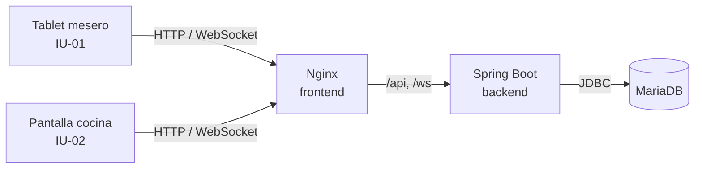

# Comanda

Sistema web de gestión operativa para restaurantes pequeños y medianos: toma de pedidos por mesa desde tablet, comandas en tiempo real a cocina y control de inventario por receta. Proyecto de Ingeniería de Software — Universidad del Quindío.

> Los requisitos se levantaron con el **Restaurante El Buen Sabor** como cliente de referencia. El nombre del restaurante es configurable (`RESTAURANTE_NOMBRE`), así que el mismo sistema sirve para cualquier establecimiento.

## Alcance de esta versión (v0.1)

Esta versión implementa únicamente el **CU-01 — Gestionar Pedido** (funcionalidades F-01 a F-13 del plan de requisitos). Cobro y cierre de caja (CU-02), gestión de menú (CU-03), inventario (CU-04), mesas y reservas (CU-05) y reportes (CU-06) se añadirán en versiones posteriores.

Incluye además el **catálogo de recetas** (ingredientes y cantidades por plato) y una **semilla de inventario**, necesarios para que el sistema valide la disponibilidad de ingredientes antes de enviar un pedido a cocina.

## Stack

| Capa | Tecnología |
|---|---|
| Base de datos | MariaDB 11.4 · migraciones con Flyway |
| Backend | Spring Boot 3.4 (Java 21) · JPA · Spring Security (JWT) · WebSocket/STOMP |
| Frontend | Angular 19 (componentes standalone, signals) · `@stomp/stompjs` |
| Contenedores | Docker Compose · Nginx sirve el frontend y hace de proxy a la API |



## Puesta en marcha local

### Requisitos

- [Docker Desktop](https://www.docker.com/products/docker-desktop/) (o Docker Engine + Compose v2)
- Git

No hace falta instalar Java, Node ni MariaDB: todo se compila y ejecuta dentro de los contenedores.

### Pasos

```bash
git clone https://github.com/<usuario>/comanda.git
cd comanda
cp .env.example .env        # en Windows (PowerShell): copy .env.example .env
docker compose up --build
```

La primera vez tarda unos minutos (descarga imágenes y dependencias). Cuando termine:

| Qué | Dirección |
|---|---|
| Aplicación | http://localhost:8081 |
| Documentación de la API (Swagger) | http://localhost:8081/swagger-ui.html |
| API directa | http://localhost:8080/api |
| MariaDB (cliente externo) | `localhost:3307` · usuario/clave del `.env` |

Al arrancar, Flyway crea las tablas y carga los datos iniciales automáticamente.

### Usuarios de prueba

| Usuario | Contraseña | Rol | Pantalla |
|---|---|---|---|
| `mesero1` | `mesero123` | Mesero | Tablet del mesero |
| `mesero2` | `mesero123` | Mesero | Tablet del mesero |
| `cocina` | `cocina123` | Cocinero | Pantalla de cocina |
| `admin` | `admin123` | Administrador | (módulo en CU-03 a CU-06; puede usar la API de inventario) |
| `caja` | `caja123` | Cajero | (módulo en CU-02) |

### Probar el flujo completo del CU-01

1. Abra dos ventanas: una con `mesero1` y otra con `cocina` (puede usar una ventana de incógnito para la segunda).
2. En la tablet, toque una mesa verde, agregue platos y confirme. La mesa pasa a rojo y la comanda aparece en cocina al instante.
3. En cocina, pulse **Iniciar preparación**, marque los platos a medida que salen y luego **Marcar como listo**.
4. En la tablet aparece la notificación verde de plato listo. Pulse **Marcar servido**.

Para probar la validación de stock: la semilla deja **Chicharrón** con 150 g, suficiente para una sola bandeja paisa. Si pide dos, el sistema rechaza el pedido indicando el plato afectado sin perder los demás. **Mojarra frita** aparece como *Sin stock* y **Cazuela de mariscos** no aparece porque está suspendida.

Para abrir la tablet desde un dispositivo real en la misma red Wi-Fi, use `http://<IP-de-su-PC>:8081`.

### Comandos útiles

```bash
docker compose up -d --build     # arrancar en segundo plano
docker compose logs -f backend   # ver los logs del backend
docker compose down              # detener
docker compose down -v           # detener y BORRAR la base de datos (vuelve a los datos iniciales)
```

> Como aún no existe la facturación (CU-02), las mesas quedan ocupadas después de servir. Para volver a empezar con todas las mesas libres use `docker compose down -v`.

## Catálogo de recetas e inventario

| Archivo | Contenido |
|---|---|
| `backend/src/main/resources/db/migration/V1__esquema.sql` | Tablas |
| `backend/src/main/resources/db/migration/V2__datos_iniciales.sql` | Mesas, usuarios, ingredientes, platos y **recetas** |
| `backend/src/main/resources/db/migration/R__stock_inventario.sql` | **Semilla de stock** (editable) |

Cada receta indica cuánto de cada ingrediente consume **una unidad** del plato. La disponibilidad se calcula así:

- **Menú (F-02):** un plato está disponible si hay stock para preparar al menos una unidad.
- **Al confirmar (F-05):** se suma el consumo de todo el pedido (cantidad de receta × unidades) y se compara con el stock, con los ingredientes bloqueados en la base de datos (`SELECT … FOR UPDATE`) para que dos tablets no gasten el mismo stock a la vez.
- **Descuento (F-06):** en la misma transacción que registra el pedido. Cada movimiento queda en `movimiento_inventario`.

### Cargar stock

**Opción 1 — Semilla (desarrollo).** Edite las cantidades en `R__stock_inventario.sql` y reinicie el backend:

```bash
docker compose up -d --build backend
```

Flyway detecta que el archivo cambió y lo vuelve a aplicar. La semilla **fija** el stock al valor indicado (no suma).

**Opción 2 — Entrada de mercancía (con el sistema en marcha).** Suma stock a un ingrediente. Requiere rol administrador:

```bash
# 1. Iniciar sesión como admin
TOKEN=$(curl -s -X POST http://localhost:8080/api/auth/login \
  -H "Content-Type: application/json" \
  -d '{"username":"admin","password":"admin123"}' | sed 's/.*"token":"\([^"]*\)".*/\1/')

# 2. Ver ingredientes y sus ids
curl -s http://localhost:8080/api/inventario -H "Authorization: Bearer $TOKEN"

# 3. Sumar 500 g de chicharrón (ajuste el id)
curl -s -X POST http://localhost:8080/api/inventario/entradas \
  -H "Authorization: Bearer $TOKEN" -H "Content-Type: application/json" \
  -d '{"ingredienteId": 4, "cantidad": 500, "observacion": "Pedido proveedor"}'
```

También puede hacerlo desde Swagger (`/swagger-ui.html` → *Authorize* con el token). El catálogo completo de recetas con el stock actual está en `GET /api/recetas`.

## Desarrollo sin reconstruir contenedores

Para iterar más rápido, levante solo la base de datos en Docker y ejecute backend y frontend en su máquina (requiere Java 21, Maven y Node 20+):

```bash
docker compose up -d db

# Backend (en otra terminal)
cd backend
DB_PORT=3307 DB_PASSWORD=comanda_dev mvn spring-boot:run

# Frontend (en otra terminal) → http://localhost:4200
cd frontend
npm install
npm start
```

`ng serve` redirige `/api` y `/ws` a `localhost:8080` mediante `proxy.conf.json`.

### Pruebas

```bash
cd backend && mvn test
```

Incluye pruebas unitarias de la máquina de estados del pedido (RD-03) y del cálculo de disponibilidad y consumo por receta.

## API y tiempo real

| Método | Ruta | Rol | Funcionalidad |
|---|---|---|---|
| POST | `/api/auth/login` | — | Iniciar sesión (devuelve JWT) |
| GET | `/api/mesas` | Mesero | F-01 Estado de mesas |
| GET | `/api/mesas/{numero}/pedido-activo` | Mesero | F-01 Pedido activo de la mesa |
| GET | `/api/menu` | Mesero | F-02 Menú con disponibilidad |
| POST | `/api/pedidos` | Mesero | F-03, F-05, F-06, F-07 Registrar y confirmar pedido |
| GET | `/api/pedidos/cocina` | Cocinero | F-09 Comandas activas |
| PATCH | `/api/pedidos/{id}/estado` | Cocinero | F-10 Iniciar preparación / marcar listo |
| PATCH | `/api/pedidos/{id}/detalles/{detalleId}` | Cocinero | F-10 Marcar plato preparado |
| GET | `/api/pedidos/notificaciones` | Mesero | F-11 Notificaciones pendientes |
| POST | `/api/pedidos/{id}/servido` | Mesero | F-12 Marcar servido |
| POST | `/api/pedidos/{id}/anular` | Mesero, Admin | F-13 Anular pedido |
| GET | `/api/recetas` | Admin | Catálogo de recetas |
| GET / POST | `/api/inventario`, `/api/inventario/entradas` | Admin | Stock y entradas |

Eventos STOMP (endpoint `/ws`): `/topic/mesas`, `/topic/menu`, `/topic/cocina`, `/topic/meseros/{usuarioId}`, `/topic/inventario/alertas`. Se publican solo después de que la transacción se confirma.

## Trazabilidad con el plan de requisitos

| ID | Funcionalidad | Jira | Implementación |
|---|---|---|---|
| F-01 | Seleccionar mesa y consultar su pedido activo | EBS-1 | ✅ Cuadrícula 4 columnas con colores, actualizada por WebSocket |
| F-02 | Consultar menú disponible por categoría | EBS-2 | ✅ Disponibilidad por receta; suspendidos ocultos; sin stock deshabilitados |
| F-03 | Registrar pedido asociado a una mesa | EBS-3 | ✅ `crearPedido` transaccional; rechaza lista vacía, mesa ocupada y rol distinto a mesero |
| F-04 | Modificar pedido antes de confirmarlo | EBS-4 | ✅ Controles +/−/eliminar de 44 px; sin edición tras confirmar |
| F-05 | Validar disponibilidad al confirmar | EBS-5 | ✅ Revalidación con bloqueo de filas; conserva los demás ítems |
| F-06 | Descontar ingredientes al confirmar | EBS-6 | ✅ Misma transacción; movimientos auditados; alerta al llegar al mínimo |
| F-07 | Enviar comanda a cocina en tiempo real | EBS-7 | ✅ Evento WebSocket tras el commit |
| F-08 | Almacenar y reenviar comandas sin conexión | EBS-8 | ⚠️ Parcial (ver pendientes) |
| F-09 | Visualizar comandas y tiempo en cola | EBS-9 | ✅ Cuadrícula 3 columnas, temporizador verde/ámbar/rojo, leyenda |
| F-10 | Marcar plato / pedido como listo | EBS-10 | ✅ Máquina de estados sin saltos ni retrocesos; bloqueo de doble pulsación |
| F-11 | Notificar al mesero que el plato está listo | EBS-11 | ✅ Solo al mesero asignado; reenvío cada 5 min si no se atiende |
| F-12 | Marcar pedido como servido | EBS-12 | ✅ Pasa a *Entregado* y retira la notificación |
| F-13 | Anular pedido | EBS-13 | ⚠️ Provisional (ver pendientes) |

## Decisiones provisionales y temas por validar con el cliente

Estos puntos aparecen como abiertos en el plan de requisitos. Se tomó una decisión razonable para poder avanzar; cambiarla es sencillo.

- **F-08 (conflicto RF-02 vs. M-03):** los pedidos se guardan siempre en el servidor, así que no se pierden si cae la pantalla de cocina; al reconectarse, la pantalla recarga todas las comandas activas. No hay cola con confirmación de recepción (ACK) ni almacenamiento en la tablet si la tablet pierde la red.
- **F-10 (estado *En preparación*):** lo marca el cocinero con el botón *Iniciar preparación*, como en el diagrama de secuencia 2.
- **F-11:** la notificación es por pedido completo (lista todos sus platos). Se corrigió la redacción de RF-04: se notifica al marcar **listo**, no servido.
- **F-13:** solo se puede anular un pedido en estado *Registrado* (coincide con el diagrama de estados). Puede hacerlo el mesero que lo tomó o un administrador; se reintegran los ingredientes, se libera la mesa y queda registrado quién, cuándo y por qué.
- **F-04:** no se pueden agregar platos a un pedido ya enviado a cocina.
- **Mesas reservadas:** se permite abrir pedido en una mesa *Reservada* (RD-01 solo lo prohíbe si está *Ocupada*).
- **Platos sin receta** se consideran siempre disponibles.

## Pendientes técnicos conocidos

- El canal WebSocket no exige autenticación: solo difunde eventos, pero cualquiera en la red podría suscribirse. Conviene autenticar la conexión STOMP con el JWT.
- Faltan pruebas de integración con base de datos real (p. ej. Testcontainers) para la concurrencia de F-05 y la atomicidad de F-06.
- HTTPS (RNF-01) se configurará al desplegar fuera del entorno local.

## Estructura del repositorio

```
comanda/
├── docker-compose.yml
├── .env.example
├── backend/                      Spring Boot
│   └── src/main/
│       ├── java/co/edu/uniquindio/comanda/
│       │   ├── auth/             inicio de sesión y JWT
│       │   ├── config/           seguridad, WebSocket, OpenAPI
│       │   ├── mesa/             F-01
│       │   ├── menu/             F-02 y catálogo de recetas
│       │   ├── inventario/       stock y movimientos
│       │   ├── pedido/           F-03 a F-13
│       │   └── tiemporeal/       eventos WebSocket
│       └── resources/db/migration/   esquema y semillas
└── frontend/                     Angular
    └── src/app/
        ├── core/                 servicios, modelos, autenticación
        └── features/
            ├── mesero/           IU-01 Tablet del mesero
            └── cocina/           IU-02 Pantalla de cocina
```

## Autores

- Sebastián José Lesmes Muñoz
- Kevin David Puerta Hidalgo

Ingeniería de Sistemas y Computación — Universidad del Quindío, 2026.
