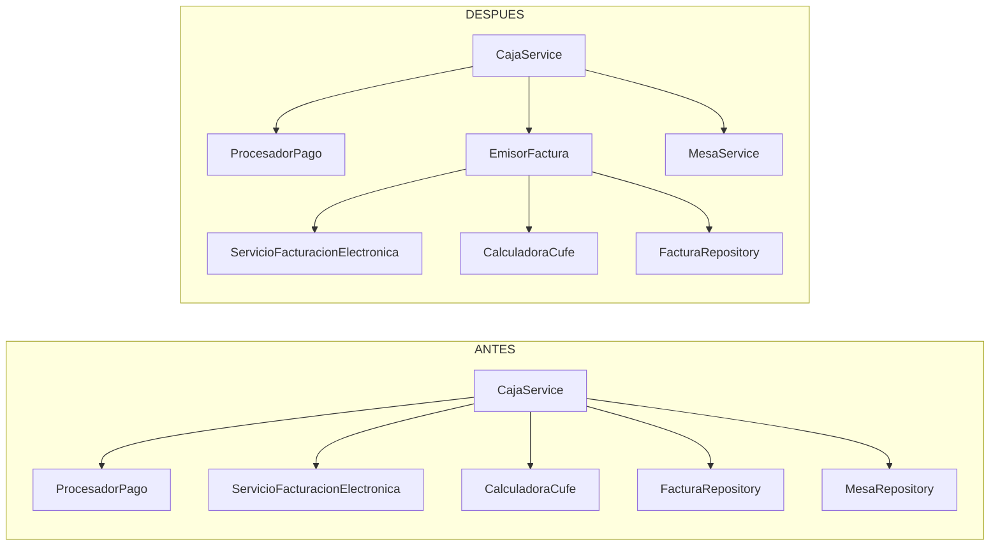

# Diagnóstico técnico y refactorización · CU-02 Cobro y facturación electrónica

Ingeniería de Software II · Universidad del Quindío · Taller de refactorización

> **Estado:** completo. Hallazgos H-01 y H-02 refactorizados y verificados; H-03 queda como defecto pendiente.
> Las líneas citadas en la sección 3 corresponden al commit base **`578580c`** (antes de cualquier cambio).

## 1. Contexto

| Dato | Valor |
|---|---|
| Equipo | Sebastián José Lesmes Muñoz · Kevin David Puerta Hidalgo |
| Profesor | Juan Manuel Cardona |
| Repositorio | https://github.com/SSeanjjo/gestion-restaurantes |
| Rama de trabajo | `feature/parcial-2-arquitectura-cu02` |
| Funcionalidad elegida | **CU-02 · Cobrar la cuenta y emitir la factura electrónica** (`registrarFactura`, Contrato 3) |
| Tecnología | Java 21 · Spring Boot 3.4 · JPA/Hibernate · MariaDB · JUnit 5 + Mockito |
| Arquitectura | Monolito modular en capas (controlador → servicio → repositorio → entidad), eventos de dominio y puertos/adaptadores hacia el banco y la DIAN |
| Requisitos relacionados | RF-06 (total automático), RF-08 (método de pago), RD-05 (solo se cobra un pedido entregado), F-15 a F-19 (cuentas, cobro, factura), Contrato 3 |

**Por qué esta funcionalidad.** Es una transacción de negocio que toca **cinco entidades**
(`Pedido`, `Mesa`, `Factura`, `Pago`, `Usuario`) y **dos sistemas externos** (pasarela bancaria y DIAN).
Además tiene una regla de compensación (reversar la tarjeta si falla la factura), por lo que concentra
decisiones de diseño reales.

## 2. Arquitectura real de la funcionalidad

### 2.1 Componentes (rastreados en el código)

| Capa | Componente | Ruta (`backend/src/main/java/co/edu/uniquindio/comanda/`) | Responsabilidad declarada |
|---|---|---|---|
| Controlador | `CajaController.cobrar` | `caja/CajaController.java` (líneas 57–63) | Autoriza el rol (`CAJERO`/`ADMINISTRADOR`) y delega. **No** contiene reglas de negocio. |
| Servicio (Facade) | `CajaService.cobrar` | `caja/CajaService.java` (líneas 115–134) | Orquesta el cobro en una transacción |
| Estrategias | `ProcesadorPago` → `PagoEfectivo`, `PagoTarjeta` | `caja/pago/` | Validan y procesan cada parte del pago |
| Puerto/Adaptador | `PasarelaPago` → `PasarelaPagoSimulada` | `caja/pago/` | Autoriza y reversa tarjetas (IS-01) |
| Puerto/Adaptador | `ServicioFacturacionElectronica` → `DianSimulada` | `caja/dian/` | Valida la factura ante la DIAN (IS-02) |
| Dominio | `Desglose`, `Factura` (+ `Builder`), `Pago`, `Pedido.esCobrable/marcarFacturado`, `Mesa.liberar` | `caja/`, `pedido/`, `mesa/` | Invariantes: RD-05, base e impuesto, estado del pedido y de la mesa |
| Persistencia | `PedidoRepository.bloquearPorId`, `FacturaRepository`, `MesaRepository.findByIdParaActualizar`, `UsuarioRepository` | cada módulo | Bloqueo pesimista de pedido y mesa |
| Eventos | `Eventos.MesaCambiada`, `Eventos.CajaActualizada` → `PublicadorTiempoReal` | `tiemporeal/` | Notifican a las pantallas después del commit |

### 2.2 Flujo (estado actual)

```mermaid
sequenceDiagram
    autonumber
    participant UI as IU-03 Caja
    participant C as CajaController
    participant S as CajaService
    participant P as ProcesadorPago (estrategia)
    participant B as PasarelaPago (banco)
    participant D as DIAN
    participant BD as Repositorios / BD
    UI->>C: POST /api/caja/cuentas/{id}/cobro
    C->>S: cobrar(pedidoId, solicitud, cajeroId)
    S->>S: jornada.exigirCajaAbierta()
    S->>BD: usuarios.findById, pedidos.bloquearPorId (FOR UPDATE)
    S->>S: RD-05, YA_FACTURADO, suma de pagos = total
    loop cada parte del pago (tarjetas primero)
        S->>P: procesar(parte)
        P->>B: autorizar (solo tarjeta)
    end
    S->>BD: facturas.save(Factura.builder()…)
    S->>S: numero + CUFE (CalculadoraCufe)
    S->>D: validarFactura(documento)
    alt DIAN rechaza
        S->>P: revertir(pago) → B.reversar
        S-->>C: DIAN_RECHAZO (rollback)
    else DIAN acepta
        S->>BD: pedido.marcarFacturado(); mesas.findByIdParaActualizar → mesa.liberar()
        S-->>UI: eventos MesaCambiada + CajaActualizada (tras el commit)
    end
```

### 2.3 Pruebas que protegen hoy la funcionalidad

| Prueba | Qué cubre |
|---|---|
| `CajaServiceTest` (4 casos) | Cobro dividido feliz, pagos que no cuadran, rechazo de la DIAN con reverso de la tarjeta, pedido no entregado |
| `ProcesadoresPagoTest` | Efectivo insuficiente, cambio, tarjeta rechazada |
| `DesgloseTest`, `CalculadoraCufeTest`, `ResumenJornadaTest` | Funciones puras del dominio |
| *Sin pruebas* | Anulación de pedido (`PedidoService.anular`), publicación de eventos del cobro, falla del reverso |

## 3. Hallazgos

Cada afirmación se verificó contra el código y, cuando era posible, contra una ejecución
(`evidencias/Caracterizacion.java`, resultado en `evidencias/antes.txt`). Se separan **hechos**
(comprobados) de **hipótesis**.

### H-01 · `CajaService` mezcla la emisión de la factura electrónica con la orquestación del cobro

| Campo | Contenido |
|---|---|
| **ID / Tipo** | H-01 · **Deuda técnica** (cohesión y responsabilidad única) |
| **Ubicación** | `caja/CajaService.java`, método `emitirFactura`, líneas **176–194**; constructor líneas **58–71**; imports de `CalculadoraCufe`, `ServicioFacturacionElectronica` y `DocumentoFactura` en las líneas **24–26** |
| **Evidencia** | `String numero = config.prefijo() + "-" + factura.getId();` · `String cufe = CalculadoraCufe.calcular(numero, …, config.nitEmisor(), config.claveTecnica(), config.ambiente());` · `dian.validarFactura(new DocumentoFactura(numero, …, cufe))` · `throw new NegocioException(HttpStatus.BAD_GATEWAY, "DIAN_RECHAZO", …)` |
| **Observación (hechos)** | La clase tiene **9 dependencias en el constructor**, importa **8 paquetes ajenos** y tiene **9 referencias** a tipos de la DIAN/CUFE. Cambia por cinco razones distintas: (a) reglas del desglose, (b) medios de pago y compensación, (c) **numeración, CUFE y protocolo de la DIAN**, (d) ciclo de vida del pedido/mesa y (e) consultas para IU-03. La razón (c) evoluciona de forma independiente (resoluciones de la DIAN, versión del algoritmo del CUFE) y ya tiene otro cliente: `CierreCajaService` también habla con la DIAN. |
| **Criterio** | Principio de responsabilidad única (S de SOLID), cohesión, **testabilidad**: para probar el número y el CUFE hay que ejecutar todo `cobrar` con 6 *mocks* y fijar el `id` de la factura con reflexión (`CajaServiceTest`, líneas 67–71). |
| **Impacto y riesgo** | Cualquier cambio en la factura electrónica obliga a modificar y volver a probar la clase que también cobra y libera la mesa. El riesgo de regresión recae en el flujo con dinero. |
| **Acción propuesta** | *Extract Class*: crear `EmisorFactura` (construye, numera, calcula el CUFE y valida ante la DIAN) e inyectarlo en `CajaService`. |
| **Verificación** | Caracterización C1, C3, C8 idénticas antes y después; nuevas pruebas unitarias de `EmisorFactura`. |
| **Estado** | Pendiente → *seleccionado* |

### H-02 · El cobro libera la mesa saltándose el módulo `mesa` (y la secuencia está duplicada)

| Campo | Contenido |
|---|---|
| **ID / Tipo** | H-02 · **Riesgo arquitectónico** (límites del módulo) y duplicación |
| **Ubicación** | `caja/CajaService.java`, método `cerrarPedido`, líneas **197–202**; `pedido/PedidoService.java`, método `anular`, líneas **202–210** |
| **Evidencia** | `Mesa mesa = mesas.findByIdParaActualizar(pedido.getMesa().getId()).orElseThrow(); mesa.liberar(); eventos.publishEvent(new Eventos.MesaCambiada(PedidoMapper.mesa(mesa, null)));` (en caja) y `mesa.liberar();` … `eventos.publishEvent(new Eventos.MesaCambiada(PedidoMapper.mesa(mesa, null)));` (en pedido) |
| **Observación (hechos)** | Dos servicios de módulos distintos repiten la regla «liberar la mesa y avisar a las tablets». El paquete `caja` usa directamente `MesaRepository` (3 referencias) y arma un `MesaDto` con un mapper del módulo `pedido`. Existe `MesaService`, pero solo expone lecturas. |
| **Criterio** | Encapsulamiento del módulo (el dueño del ciclo de vida de `Mesa` es `mesa`), DRY, capas: un servicio de dominio no debe llegar a la persistencia de otro módulo. |
| **Impacto y riesgo** | Si cambia la regla (p. ej. un estado intermedio «En limpieza»), hay que editar dos lugares. Olvidar el evento deja la cuadrícula de mesas de las tablets desactualizada. |
| **Acción propuesta** | *Move Method*: añadir `MesaService.liberar(…)` (cambia el estado y publica el evento) y que `CajaService` y `PedidoService` lo usen. |
| **Verificación** | Caracterización C1, C8, A1: mismos estados y **mismo orden de eventos**. |
| **Estado** | Pendiente → *seleccionado* |

### H-03 · La compensación del cobro no tolera que el reverso falle

| Campo | Contenido |
|---|---|
| **ID / Tipo** | H-03 · **Defecto latente** (no se manifiesta con el adaptador simulado) |
| **Ubicación** | `caja/CajaService.java`, método `revertir`, líneas **204–206**; se invoca desde las líneas **131** y **171** |
| **Evidencia** | `pagos.forEach(p -> procesador(p.getMetodo()).revertir(p));` dentro de un `catch (RuntimeException e)` que luego hace `throw e;` |
| **Observación** | **Hecho** (caracterización C9, `evidencias/antes.txt`): con un banco cuyo `reversar` lanza una excepción, (1) el error que llega al cajero es la excepción del reverso y **se pierde `DIAN_RECHAZO`**, y (2) el bucle se corta: la segunda tarjeta **no se reversa** (`Pasarela.reversar(AUT-10000)` aparece y `AUT-18000` nunca). **Hipótesis:** un banco real puede fallar por tiempo de espera; con `PasarelaPagoSimulada` no ocurre. |
| **Criterio** | Fiabilidad / tolerancia a fallos (ISO 25010), integridad financiera. |
| **Impacto y riesgo** | Un cliente puede quedar cobrado sin factura y sin que el sistema lo registre. |
| **Acción propuesta** | Intentar el reverso de **cada** pago, conservar el error original (`addSuppressed`) y registrar los reversos fallidos para conciliarlos (tabla de reversos pendientes). |
| **Verificación** | Prueba con una pasarela que falla: deben intentarse los dos reversos y propagarse `DIAN_RECHAZO`. |
| **Estado** | Pendiente (**no se interviene**, ver §4) |

## 4. Priorización

Puntaje = (impacto × riesgo) ÷ esfuerzo. Cada factor va de 1 a 3.

| ID | Impacto | Riesgo | Esfuerzo | Puntaje | ¿Conserva el comportamiento? | Decisión |
|---|:-:|:-:|:-:|:-:|---|---|
| H-01 | 3 | 3 | 2 | **4,5** | Sí | **1.ª refactorización** |
| H-02 | 2 | 2 | 1 | **4,0** | Sí | **2.ª refactorización** |
| H-03 | 3 | 3 | 3 | 3,0 | **No** (cambia lo que ocurre ante un fallo) | Pendiente, se declara como corrección de defecto |

**Razón de selección.** H-01 tiene el mayor impacto sobre la mantenibilidad y está en el flujo con
dinero, pero se puede extraer sin cambiar ningún resultado observable. H-02 es pequeña y
complementa a H-01: deja a `CajaService` hablando solo con sus colaboradores directos. H-03 es el
hallazgo más grave por su efecto financiero, pero **no es un refactor**: corregirlo cambia el
comportamiento (qué error recibe el cajero y qué se persiste), exige una decisión de negocio (cómo
conciliar un reverso fallido) y un esfuerzo mayor (nueva tabla y proceso de reintento). Se deja
registrado como defecto y como primer ítem del siguiente sprint.

## 5. Intervención

Se hicieron **dos refactorizaciones** que conservan el comportamiento observable. No se corrigió ningún defecto.

### 5.1 Primera refactorización · H-01 *Extract Class* → `EmisorFactura`

**Cambio.** Se movieron las reglas de emisión de la factura electrónica (guardar, numerar, calcular el
CUFE, validar ante la DIAN y registrar el resultado) desde `CajaService.emitirFactura` a una clase nueva,
`caja/EmisorFactura.java` (`@Component`, método `emitir(pedido, cajero, desglose, pagos)`). El cuerpo se movió
sin alterar su lógica ni su orden de operaciones. `EmisorFactura` no abre transacción propia: participa de
la de `CajaService.cobrar`, así que el rechazo de la DIAN sigue deshaciendo el guardado de la factura.



| Responsabilidad | Antes | Después |
|---|---|---|
| Orquestar el cobro y compensar | `CajaService` | `CajaService` |
| Numeración, CUFE y protocolo DIAN | `CajaService` | **`EmisorFactura`** |
| Consultas de cuentas para IU-03 | `CajaService` | `CajaService` |

### 5.2 Segunda refactorización · H-02 *Move Method* → `MesaService.liberar`

**Cambio.** `MesaService` ahora expone `liberar(Long mesaId)` (bloquea la mesa, la deja Disponible y publica
`MesaCambiada`) y `liberar(Mesa mesa)` (para quien ya la tiene bloqueada). `CajaService.cerrarPedido` y
`PedidoService.anular` la usan; desaparece la copia de la secuencia y `caja` deja de depender de
`MesaRepository`.

**Cuidado con el orden de eventos.** En `anular`, el evento `MesaCambiada` se publicaba *después* de
`PedidoCambiado`. Al delegar, la llamada se colocó justo después de publicar `PedidoCambiado`, de modo que
las pantallas reciben `PedidoCambiado → MesaCambiada → MenuActualizado → CajaActualizada`, igual que antes.
El orden de bloqueo (mesa → ingredientes) tampoco cambia, porque `anular` sigue bloqueando la mesa antes de
reintegrar el inventario y usa la variante `liberar(Mesa)` para no repetir la consulta.

### 5.3 Archivos afectados

| Archivo | Cambio |
|---|---|
| `caja/EmisorFactura.java` | **Nuevo** (H-01) |
| `caja/CajaService.java` | Usa `EmisorFactura` y `MesaService`; elimina `emitirFactura` y el acceso a `MesaRepository` |
| `mesa/MesaService.java` | Nuevos `liberar(Long)` y `liberar(Mesa)`; recibe `ApplicationEventPublisher` |
| `pedido/PedidoService.java` | `anular` delega en `MesaService.liberar` |
| `test/.../caja/EmisorFacturaTest.java` | **Nuevo**: número, CUFE y rechazo de la DIAN sin armar el cobro |
| `test/.../mesa/MesaServiceTest.java` | **Nuevo**: liberar y evento |
| `test/.../pedido/PedidoServiceAnularTest.java` | **Nuevo**: antes no había pruebas de la anulación |
| `test/.../caja/CajaServiceTest.java` | Nuevo constructor y 3 pruebas de caracterización (orden de eventos, doble cobro, rechazo del banco) |

### 5.4 Consecuencias para la arquitectura

- `CajaService` sigue siendo la *fachada* del cobro, pero ya no conoce el protocolo de la DIAN ni la persistencia de mesas: depende de colaboradores con un nombre de dominio (`EmisorFactura`, `MesaService`).
- El módulo `mesa` pasa a ser el único dueño del ciclo de vida de `Mesa` (regla de límites del monolito modular).
- La dependencia hacia la DIAN queda en un solo punto del cobro (`EmisorFactura`), que es donde se cambiaría si se integra la DIAN real.
- No se agregan dependencias cíclicas (`MesaService` depende solo de repositorios y del publicador de eventos).
- Costo: `PedidoService` pasa de 6 a 7 dependencias porque conserva `MesaRepository` para bloquear por número (ver deuda pendiente).

## 6. Verificación

### 6.1 Qué se ejecutó

| Comprobación | Resultado |
|---|---|
| **Caracterización (12 escenarios)**: `evidencias/Caracterizacion.java` sobre el código base y sobre el código refactorizado; se compara resultado, estado de pedido y mesa, facturas guardadas, llamadas a la pasarela y a la DIAN, y orden de eventos | **Salida idéntica**: `diff antes.txt despues.txt` no muestra diferencias (84 líneas) |
| **Prueba de sensibilidad**: invertir a propósito el orden de `MesaCambiada` y `PedidoCambiado` en `anular` | La caracterización **detecta** el cambio (A1 difiere). Se revirtió. Demuestra que la comparación no es ciega |
| Compilación del código y de las pruebas JUnit nuevas y modificadas | Compilan contra *stubs* de Spring/JPA/Mockito/AssertJ |
| **Suite JUnit completa** (`mvn verify`) | **No se ejecutó en el entorno de análisis** (no podía descargar dependencias). Corre en GitHub Actions en cada *push* |

Escenarios de caracterización (todos con salida idéntica antes y después):

| ID | Situación | Resultado observado (igual antes y después) |
|---|---|---|
| C1 | Cobro dividido efectivo + tarjeta | Factura `FEBS-15`, CUFE de 96 caracteres, DIAN aceptada, pedido FACTURADO, mesa DISPONIBLE; eventos `MesaCambiada`, `CajaActualizada` |
| C2 | Pagos que no suman el total | `PAGOS_NO_CUADRAN`, sin llamadas externas |
| C3 | La DIAN rechaza | `DIAN_RECHAZO`, se reversa la tarjeta, mesa sigue OCUPADA, sin eventos |
| C4 | Pedido no entregado | `PEDIDO_NO_ENTREGADO` |
| C5 | Pedido ya facturado | `YA_FACTURADO` |
| C6 | El banco rechaza la tarjeta | `PAGO_RECHAZADO`, no se guarda factura |
| C7 | Caja cerrada | `CAJA_CERRADA` |
| C8 | Efectivo con cambio | Factura emitida, sin llamadas a la pasarela |
| C9 | El reverso falla durante la compensación (H-03) | Mismo comportamiento defectuoso que antes: **no se corrigió**, solo se comprobó que el refactor no lo altera |
| A1 | Anular pedido registrado | `CANCELADO`, mesa DISPONIBLE, eventos en el orden `PedidoCambiado, MesaCambiada, MenuActualizado, CajaActualizada` |
| A2 | Anular pedido en preparación | `NO_ANULABLE` |
| A3 | Anular el pedido de otro mesero | `NO_ES_SU_PEDIDO` |

### 6.2 Análisis de la mejora (`evidencias/metricas_antes.txt` y `metricas_despues.txt`)

| Medida | Antes | Después | Lectura |
|---|---:|---:|---|
| `CajaService`: líneas | 224 | 197 | −27 |
| `CajaService`: líneas de código | 142 | 123 | −19 |
| `CajaService`: imports internos | 22 | 17 | −5 |
| `CajaService`: paquetes ajenos importados | 8 | 7 | −1 |
| `CajaService`: referencias a DIAN/CUFE | 9 | **0** | La emisión ya no se mezcla con el cobro |
| Usos de `MesaRepository` en el paquete `caja` | 3 | **0** | `caja` respeta el límite del módulo `mesa` |
| Sitios con la secuencia «liberar mesa + evento» | 2 | **1** (`MesaService`) | Regla única |
| `CajaService`: parámetros del constructor | 9 | 9 | **Sin mejora**: se cambió `ServicioFacturacionElectronica` y `MesaRepository` por `EmisorFactura` y `MesaService` |
| `PedidoService`: parámetros del constructor | 6 | 7 | **Empeora levemente** (conserva `MesaRepository` para bloquear por número) |
| Pruebas de la anulación | 0 | 2 | Antes no estaba protegida |
| Pruebas de la emisión de factura sin armar el cobro | 0 | 2 | Mejora de testabilidad |

La mejora es de **cohesión y de límites entre módulos**, no de cantidad de dependencias. El resultado de
negocio no cambia.

### 6.3 Limitaciones

- La caracterización no usa base de datos ni transacciones reales: no prueba el bloqueo pesimista ni el *rollback*. Eso lo cubren la prueba de humo de extremo a extremo y la integración continua.
- Las pruebas JUnit nuevas compilaron, pero **no se ejecutaron** localmente; hay que confirmar el resultado de GitHub Actions.
- `PasarelaPagoSimulada` y `DianSimulada` son adaptadores de prueba: H-03 no se manifiesta con ellos.

## 7. Cierre

### 7.1 Preguntas de sustentación

**¿Cuál era el problema identificado y dónde estaba?** `CajaService` (`caja/CajaService.java`) concentraba la emisión de la factura electrónica (líneas 176–194) junto con el cobro, y liberaba la mesa por su cuenta (líneas 197–202), duplicando la regla de `PedidoService.anular` (líneas 202–210).

**¿Qué principio o atributo estaba comprometido?** Responsabilidad única y cohesión (S de SOLID), encapsulamiento de los límites del módulo `mesa`, DRY y testabilidad.

**¿Qué modificación se hizo y cómo cambiaron las responsabilidades y dependencias?** *Extract Class* (`EmisorFactura`) y *Move Method* (`MesaService.liberar`). `CajaService` pasó de conocer la DIAN, el CUFE y `MesaRepository` a depender de `EmisorFactura` y `MesaService`.

**¿Qué consecuencias tiene sobre la arquitectura?** El módulo `mesa` es dueño de su ciclo de vida; la integración con la DIAN queda en un único punto del cobro; `CajaService` sigue siendo la fachada sin cambiar su contrato público. No hay dependencias cíclicas nuevas. El número de dependencias del constructor no baja.

**¿Qué evidencias demuestran que se conserva el comportamiento?** 12 escenarios de caracterización con salida idéntica antes y después (incluido el orden de los eventos), una prueba de sensibilidad que demuestra que la comparación detecta cambios y pruebas JUnit nuevas que corren en integración continua.

### 7.2 Lecciones

1. Escribir primero la caracterización fue lo que permitió refactorizar sin miedo; incluso descubrió un defecto (H-03) que ninguna prueba existente cubría.
2. El orden de los eventos es parte del comportamiento observable. Un refactor «inocente» en `anular` lo habría cambiado sin que ninguna prueba lo notara.
3. Medir evita engañarse: dos de las métricas no mejoraron (dependencias del constructor) y se reportan así.

### 7.3 Deuda técnica pendiente

| Ítem | Tipo | Siguiente paso |
|---|---|---|
| **H-03** Compensación sin tolerancia a que el reverso falle | Defecto (RF-08, integridad financiera) | Jira **R-08**: intentar todos los reversos, `addSuppressed`, registrar reversos pendientes |
| `PedidoService` aún usa `MesaRepository` para bloquear por número | Deuda técnica | Mover `bloquearMesa` a `MesaService` |
| Llamadas al banco y a la DIAN dentro de la transacción de BD con bloqueos pesimistas | **Hipótesis** de riesgo arquitectónico (no se midió) | Medir latencia con adaptadores reales; evaluar emitir la factura tras el commit |
| Falta de pruebas de integración con base de datos (Testcontainers) | Pruebas | Verificar bloqueo y *rollback* reales |

### 7.4 Vínculo con el proceso de desarrollo (Scrum)

El trabajo se organizó como un **Sprint de dos semanas** (*EBS Sprint 4*; propuesta: 28 oct – 11 nov 2026) con
la épica **E5 Refactorización y cierre de arquitectura** y las tareas R-01 a R-08
(`docs/jira/jira_import_sprint4_refactorizacion.csv`). El defecto H-03 pasa a *EBS Sprint 5*.

| Ceremonia | Cómo se aplica |
|---|---|
| Planificación | Meta del sprint: «el cobro queda con responsabilidades separadas y verificadas sin cambiar su comportamiento» |
| **Reunión diaria** (15 min) | ¿Qué hice ayer? ¿Qué haré hoy? ¿Qué me bloquea? Se registra en la tabla de abajo |
| Revisión | Demostración: escenarios C1–C9 y A1–A3 antes y después |
| Retrospectiva | Lecciones de 7.2 y deuda de 7.3 |
| Definición de hecho | Criterio de aceptación cumplido, prueba (automática o documentada) y *pull request* con integración continua en verde |

Registro de reuniones diarias (completar el equipo):

| Fecha | Quién | Ayer | Hoy | Impedimentos |
|---|---|---|---|---|
| | | | | |

### 7.5 Pregunta de cierre: ¿qué práctica habría detectado estos problemas antes de entregar?

- **Revisión de código en el *pull request* con una lista de verificación** de diseño (¿esta clase cambia por más de una razón?, ¿llama a repositorios de otro módulo?): habría señalado H-01 y H-02.
- **Pruebas de arquitectura automáticas** (por ejemplo, ArchUnit: «`caja` no depende de `MesaRepository`») en la integración continua: H-02 habría fallado el *build*.
- **Análisis estático** (SonarQube o similar) con umbrales de dependencias por clase y duplicación.
- **Pruebas de fallos de los puertos externos** (la pasarela que lanza excepción): H-03 sale al escribir el caso «¿y si el reverso falla?».
- **Definición de hecho** que incluya revisión de diseño, no solo que las pruebas pasen.

## 8. Git

| Commit | Contenido |
|---|---|
| `578580c` | Estado base (antes de la intervención) |
| `2074a72` | `docs: registrar diagnostico tecnico` (secciones 1 a 4 y evidencia «antes») |
| `c7f5cf3` | `refactor: separar la emision de la factura electronica de CajaService` (H-01) |
| `431726e` | `refactor: centralizar la liberacion de la mesa en MesaService` (H-02) |
| último commit de la rama que modifica este archivo | `docs: documentar verificacion de refactorizacion` (secciones 5 a 8, evidencia «después» y backlog del sprint) |

Rama: `feature/parcial-2-arquitectura-cu02` · Repositorio: https://github.com/SSeanjjo/gestion-restaurantes
